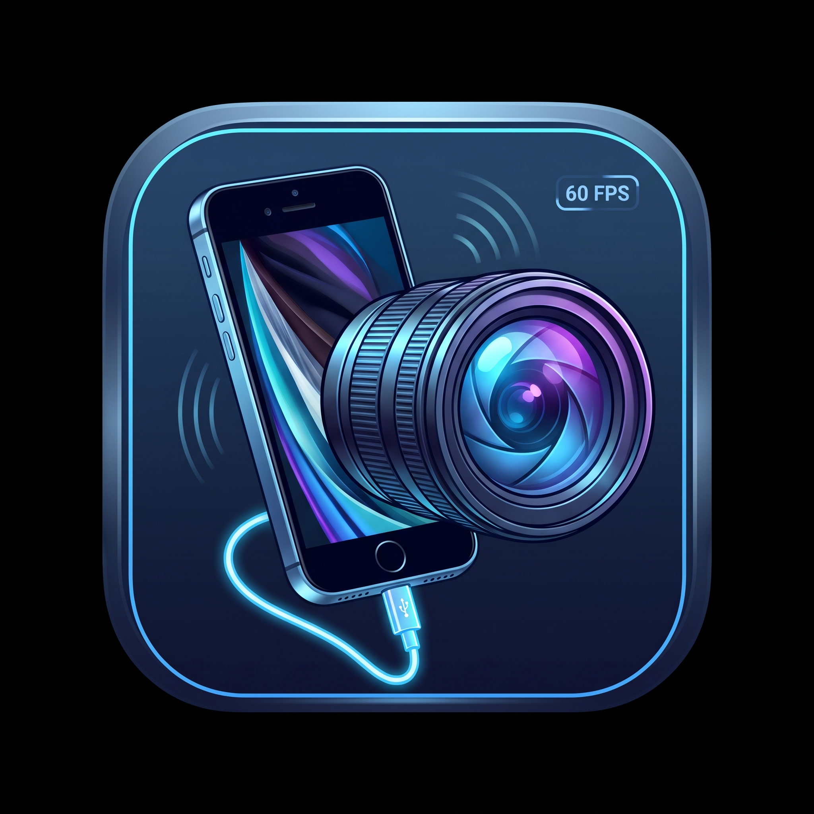

  

<h1 align="center">iPhone Webcam PC (1080p 60 FPS USB)</h1>

  🇺🇸 <b>Low-latency 1080p 60 FPS USB webcam for Windows with remote Torch & Focus (AF/MF) control.</b> 
  🇵🇱 <b>Niskoopóźnieniowa kamera internetowa Full HD 60 FPS przez kabel USB dla Windows ze zdalnym sterowaniem latarką i ostrością (AF/MF).</b>

---

### 🇺🇸 English
- **1080p 60 FPS over USB:** Direct hardware H.264 stream via USB cable with zero Wi-Fi lag.
- **Desktop Control Panel (EN/PL):** Toggle iPhone LED flashlight and switch between Auto Focus (AF) and smooth Manual Focus (MF) directly from Windows.
- **All-in-One Installer (`iPhoneWebcam_Full_Setup.exe`):** Automatically installs the app, OBS Studio (and registers OBS Virtual Camera), Apple USB drivers, Python 3.12, and Sideloadly.
- **Download:** Grab the latest Windows installer and iOS `.ipa` from **[Releases](../../releases)**.

---

### 🇵🇱 Polski
- **Obraz 1080p 60 FPS po kablu USB:** Bezpośredni strumień sprzętowy H.264 bez opóźnień sieci Wi-Fi.
- **Panel sterowania na PC (PL/EN):** Włączanie diody LED w iPhonie oraz przełączanie między autofokusem (AF) a płynną ręczną regulacją ostrości (MF) prosto z pulpitu Windows.
- **Kompletny instalator (`iPhoneWebcam_Full_Setup.exe`):** Automatycznie instaluje program, OBS Studio (wraz z rejestracją OBS Virtual Camera), sterowniki Apple USB, Pythona 3.12 oraz Sideloadly.
- **Pobieranie:** Najnowszy instalator Windows oraz plik `.ipa` na iPhone'a znajdziesz w zakładce **[Releases](../../releases)**.
